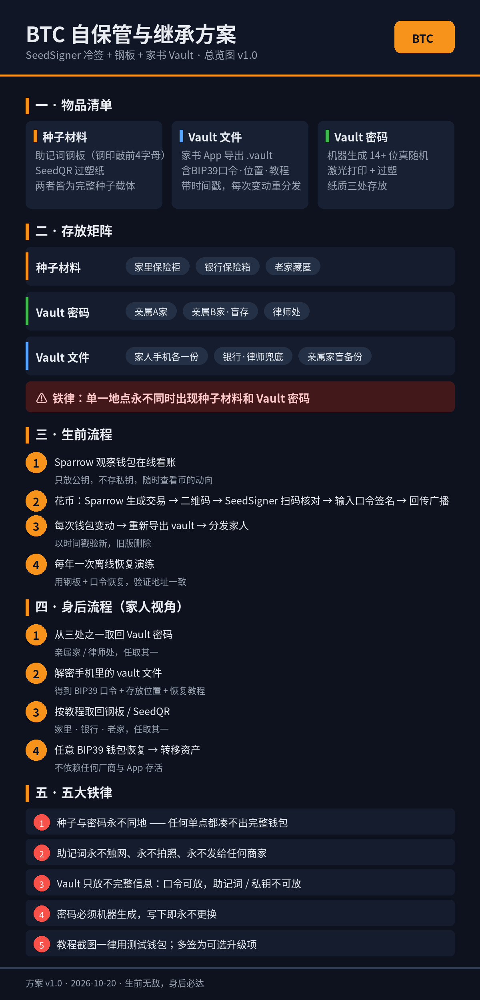
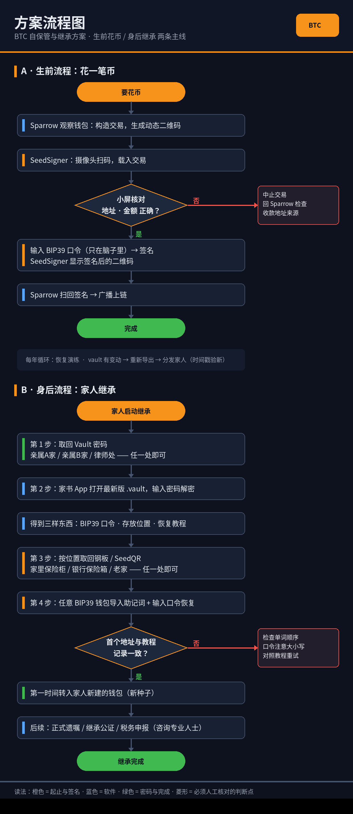
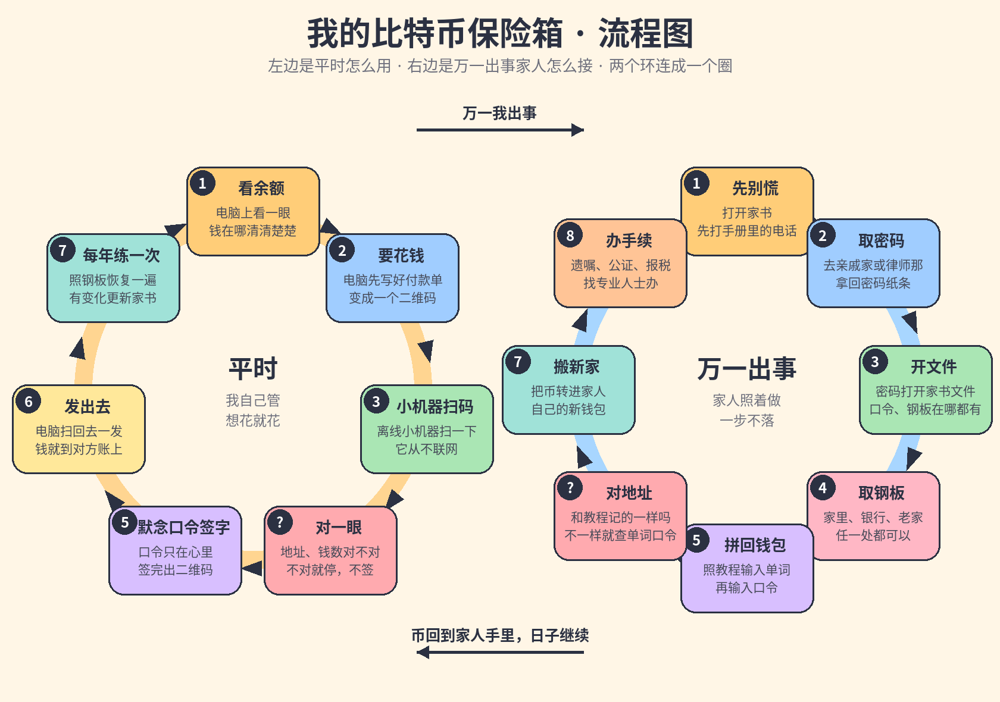

# BTC 自保管与继承方案

> 生前无敌，身后必达。

一套**不依赖任何厂商、不信任任何中间人**的比特币长期保管与身后传承方案。
核心思想：用**物理分散**代替信任，用**不完整信息**代替单点密钥。

**适用人群**：长期自持 BTC、希望自己出事后家人仍能取回的个人与家庭。

[English summary](./README-EN.md) · [总览图](./assets/btc-scheme-overview.png)

---

## 这是什么 / 不是什么

- ✅ 一套可执行的个人 BTC 保管 + 继承操作手册（流程、清单、威胁模型）
- ✅ 配合本地加密资产登记工具（见 [与登记 App 配合](./docs/05-登记App配合.md)）使用
- ❌ 不是钱包软件，不含任何代码密钥
- ❌ 不提供法律/税务建议（分配问题请咨询律师，见 [FAQ](./docs/06-FAQ.md)）
- ❌ 本仓库所有示例均为占位数据，请勿填入真实信息

## 核心设计（30 秒版）

**三类物品，三个存放地，互相隔离：**

| 物品 | 内容 | 存放三地 |
|---|---|---|
| 种子材料 | 助记词钢板、SeedQR 过塑纸（完整种子载体） | 家里保险柜 / 银行保险箱 / 老家藏匿 |
| Vault 密码 | 机器生成 14+ 位真随机，激光打印+过塑 | 亲属A家 / 亲属B家（盲存）/ 律师处 |
| Vault 文件 | 加密包：BIP39 口令 + 存放位置 + 恢复教程（带时间戳） | 家人手机各一份 / 银行·律师兜底 / 亲属家盲备份 |

**铁律：单一地点永不同时出现种子材料和 Vault 密码。**
任何单点被攻破，都凑不出完整钱包。

**生前**：Sparrow 观察钱包在线看账；花币时 SeedSigner（自攒纯离线二维码签名器）
扫码签名，配合脑中 BIP39 口令。
**身后**：家人取密码 → 解密 vault → 按教程取钢板 → 任意 BIP39 钱包恢复。

## 文档

- [01 生前流程](./docs/01-生前流程.md) — 搭建、日常花币、vault 分发、年度演练
- [02 身后流程](./docs/02-身后流程.md) — 家人视角 step-by-step（含"先打电话给谁"）
- [03 威胁模型](./docs/03-威胁模型.md) — 信任假设、攻击者画像、单点清单
- [04 执行清单](./docs/04-执行清单.md) — 采购清单、搭建步骤、验证步骤，一项项打勾
- [05 与登记 App 配合](./docs/05-登记App配合.md) — "不完整信息"原则、vault 格式要求
- [06 FAQ](./docs/06-FAQ.md) — 为什么不用多签/硬件钱包？口令忘了怎么办？……
- [07 Multisig 升级路径（可选）](./docs/07-multisig升级路径.md)
- [08 费用清单](./docs/08-费用清单.md) — 实施本方案的材料费用明细

## 安全声明

- 本方案的安全性**不依赖保密**（Kerckhoffs 原则）：公开方法论不会削弱它。
- 欢迎提 Issue / PR 指出漏洞 —— 社区 review 是免费的安全审计。
- 本仓库不含、也永远不会含任何真实密钥、地址、位置信息。

## License

[CC BY-SA 4.0](./LICENSE) —— 可自由使用、改编，需署名并以相同方式共享。
